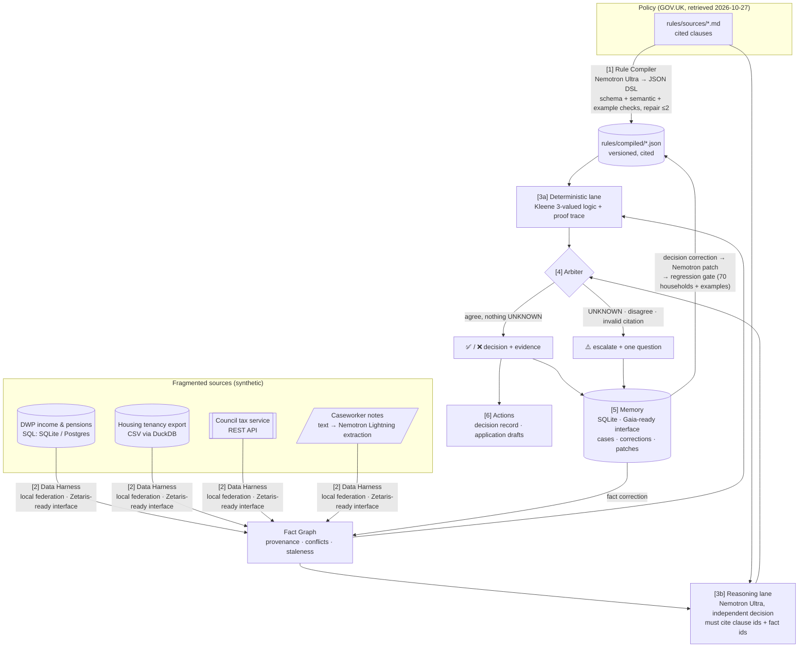

<p align="center"></p>

<h1 align="center">Unclaimed</h1>
<p align="center"><b>Find benefits. Prove decisions.</b><br>
Open Agent Hackathon 2026 · Track 3: Reasoning Architecture · Team <b>One-Man Agent Show</b><br>
<a href="https://github.com/Firas-Bennani/Unclaimed.open_agent_hackathon_2026">https://github.com/Firas-Bennani/Unclaimed.open_agent_hackathon_2026</a></p>

---

## The problem

Billions of pounds of public support (Pension Credit, Attendance Allowance, Council Tax Reduction, the Warm Home Discount) go unclaimed every year. The rules are long and spread across many documents. The facts needed to check them sit in separate systems: DWP records, housing association exports, council tax accounts and caseworkers' notes. Welfare-rights caseworkers at charities and councils check eligibility by hand.

Errors hurt in both directions. A wrong **"yes"** creates overpayment debt for a household that can't afford it. A wrong **"no"** leaves a pensioner without money they are owed.

**User:** a welfare-rights caseworker. **Job to be done:** for one household, find every benefit they're entitled to, with evidence they can stand behind.

## What Unclaimed does

For each household, Unclaimed:

1. **Gathers facts** from four fragmented sources: SQL, CSV, a REST API and free-text notes. Every fact keeps its provenance: source, record id, field, value and date.
2. **Evaluates eligibility** for four UK benefits against rules compiled from GOV.UK policy text.
3. Returns per benefit: ✅ **eligible** (£/month), ❌ **not eligible** (with the rule reason), or ⚠️ **cannot decide**, with **one precise question** for the caseworker.
4. **Attaches evidence** to every conclusion: the rule clause (with its GOV.UK source link) and the exact data records it relied on.
5. **Drafts pre-filled applications** for the eligible benefits.
6. **Learns from corrections.** A fact correction is stored with caseworker provenance and the case re-runs. A decision correction becomes a Nemotron-proposed **rule patch**, accepted only if the regression suite shows **zero regressions**.

> *"Unclaimed helps caseworkers find benefits households are entitled to. It makes decisions it can prove, refuses to guess when evidence is missing, and gets better with every correction — and we measured it against a standard AI agent."*

<!-- SCREENSHOTS -->

## Architecture



**Why it's reliable:**

- **Two independent lanes.** A deterministic engine evaluates the compiled DSL. Separately, Nemotron reasons from the clause text and the facts. The arbiter decides only when the two agree. Disagreement, any UNKNOWN, or a citation to a clause or fact that doesn't exist all escalate. A wrong "yes" is treated as worse than an escalation.
- **Three-valued logic.** Missing, conflicting or stale facts are UNKNOWN, never silently guessed. Kleene logic still decides when the answer doesn't depend on the unknown (e.g. "income alone is already over the limit").
- **Conflicts are surfaced, not resolved by fiat.** If DWP says £200/week and the housing export says £231.50/week, both are shown and the caseworker is asked.
- **Every number is traceable.** Decision → clause (GOV.UK URL) → fact → source record id → date.
- **Rules are code, but written by Nemotron.** The compiler turns policy text into a constrained JSON DSL, validated by pydantic + semantic checks + hand-written rule examples, with a bounded repair loop.
- **Learning is gated.** A Nemotron rule patch is applied only if the full regression suite shows zero regressions *and* the reported case is fixed.

## How we use the sponsors

| Sponsor | What it does in Unclaimed | Status |
|---|---|---|
| **NVIDIA Nemotron** | `nemotron-3-ultra-550b-a55b` compiles policy text into the rule DSL, runs the independent reasoning lane, proposes rule patches, and powers the baseline. `nemotron-3.5-lightning-30b-a3b` (thinking off) extracts facts from caseworker notes, with verbatim quotes as evidence. All calls go through a throttled client with backoff, schema validation + repair, and a record/replay cache (which also powers Demo mode). | ✅ **Live** (build.nvidia.com) |
| **Zetaris** | The Data Harness sits behind a `DataHarness` interface designed for federated queries. Today the `LocalFederatedHarness` federates SQL (SQLite/Postgres), CSV (DuckDB), a REST API and text. | ⚠️ **Fallback.** Zetaris Cloud needs an account + API token we didn't have. Switch with `DATA_BACKEND=zetaris` once credentials exist. We did not invent an endpoint. |
| **Meterless (Gaia)** | Case memory, corrections, rule patches and active rule versions sit behind a `Memory` interface. | ⚠️ **Fallback: `SqliteMemory`.** Gaia is a proprietary app and we found no public memory API. We did not invent one. |

The UI header always shows which backend is live.

## Evaluation: Unclaimed vs a standard AI agent

70 synthetic households × 4 benefits = **280 decisions** (248 decidable from the available evidence, 32 that should be escalated). Ground truth comes from an independent plain-Python reference implementation of the policy text (`eval/reference.py`) plus hand-labelled escalations. The baseline is the **same Nemotron model** given the policy text and every raw record. Full details, definitions and every disagreement: [EVAL.md](EVAL.md). All numbers come from real runs (`eval/results.json`).

| Metric | Standard agent (Nemotron + raw data) | **Unclaimed** | Deterministic lane only (ablation) |
|---|---|---|---|
| Accuracy on decidable cases | 79.4% | **98.4%** | 100.0% |
| Wrong "yes" (overpayment risk) | 21 (7.5%) | **0** | 0 |
| Wrong "no" | 0 | **0** | 0 |
| Escalation recall (asks when evidence is missing) | 62.5% | **100%** | 100% |
| Escalation precision | 32.3% | **88.9%** | 100% |
| Coverage (decisions made) | 77.9% | **87.1%** | 88.6% |
| Selective accuracy (correct among decisions made) | 90.4% | **100%** | 100% |
| Amount within £0.50 | 77.2% | **100%** | 100% |
| Citation validity | 98.9% | **100%** | 100% |
| Latency / tokens per household | 155 s / 7.4k | 144 s / 7.2k | 3.4 s / 0.5k |

**Reading this honestly:**
- **Against the standard agent:** the same model, given the same data, gave **21 wrong "yes"** answers, missed 37.5% of the cases that needed a human, and got 23% of amounts wrong. Unclaimed made **zero wrong decisions**: every case it decided was right, and it escalated every case that needed escalating.
- **Why the deterministic lane alone scores 100%:** the labels come from a reference implementation of the same simplified policy, and on this synthetic set both the Nemotron-compiled rules and the notes extraction turned out correct. So on this set the rule engine can't be beaten. The Nemotron reasoning lane is an **independent cross-check against rule-compilation and extraction errors**. This test set contains none, so here it only adds escalations: 4 unnecessary ones, 3 of them Nemotron fairly pointing out that Scotland's CTR scheme isn't modelled. We keep the second lane because real rules get mis-compiled and real notes get mis-read. We have not shown that benefit on this test set.
- Two earlier runs exposed real bugs (negative statements dropped by extraction; over-strict staleness). They were fixed with general policies applied equally to the baseline, and everything was re-scored on one code version. See the run history in [EVAL.md](EVAL.md).


## Run it

**Prerequisites:** Python 3.11+, Node 20+. No Docker needed.

```powershell
# 1. install
python -m pip install -r backend/requirements.txt
cd frontend; npm install; cd ..

# 2. demo (offline: replays recorded Nemotron responses, resets memory, serves UI + API)
powershell -File scripts/demo.ps1        # or: make demo
# → open http://localhost:8000
```

Live mode (calls Nemotron and records new responses): copy `.env.example` to `.env`, set `NVIDIA_API_KEY`, then

```powershell
cd backend; python -m uvicorn unclaimed.api:app --port 8000     # API (serves the built UI too)
cd frontend; npm run dev                                          # dev UI on http://localhost:5173
```

Other commands (`make <target>` or the `scripts/*.ps1` equivalents):

| Task | Command |
|---|---|
| Regenerate synthetic data (seeded) | `cd backend; python -m unclaimed.datagen` |
| Compile rules with Nemotron | `cd backend; python -m unclaimed.compiler` |
| Tests | `cd backend; python -m pytest -q` (or `scripts/test.ps1`) |
| Evaluation | `python eval/run.py` (or `scripts/eval.ps1`) |
| Record the demo's Nemotron responses | `python scripts/rehearse.py` |
| Docker (Postgres + mock council API + app) | `docker compose up --build` |

## Repository map

```
backend/unclaimed/   config, llm (Nemotron client + cache), dsl (schema + Kleene evaluator), compiler,
                     harness/ (sources + local federation + notes extraction), factgraph, reasoning,
                     arbiter, pipeline, memory, learning (patch gate), actions, api, mock_council, datagen
backend/tests/       pytest: DSL, 3-valued logic, rule examples, conflicts/staleness, arbiter, citations, API
rules/sources/       policy excerpts with GOV.UK URLs + retrieval date   rules/compiled/  Nemotron-compiled DSL
rules/examples/      hand-written rule examples (used by tests, the compiler repair loop and the patch gate)
data/generated/      the 4 synthetic sources + case list               data/llm_cache/  record/replay cache
eval/                reference.py (independent ground truth), run.py, results.json
frontend/            React + Vite + TypeScript + Tailwind
docs/                DEMO_SCRIPT.md, SUBMISSION.md, screenshots/
```

## Limitations & ethics

- **All data is synthetic.** No real person's data is used anywhere. Names, NI numbers (`QQ…` prefix) and postcodes (`ZZ…`) are fictional.
- **Simplified rules.** Four schemes, simplified (State Pension age rounded to 66/67; couples need both partners over SPA; the CTR model uses a national pensioner taper; Warm Home Discount assumes a participating supplier). Thresholds come from GOV.UK pages retrieved on 2026-10-27, and the CTR capital limit/taper come from SI 2012/2885. See `rules/sources/`.
- **Demo rule pack.** The live demo starts with the Pension Credit pack on the *previous year's* rates (2025-26: £227.10/£346.60), so the learning loop has something real to fix. The UI labels this. The evaluation always uses the 2026-27 pack.
- **Not legal advice.** Unclaimed supports a trained caseworker. It never submits anything, and every draft is marked for review.
- **Human in the loop by design.** When evidence is missing or contradictory, the system asks rather than guesses.
- **Sponsor integrations:** Zetaris and Gaia run as interface + local fallback (see above).
